

  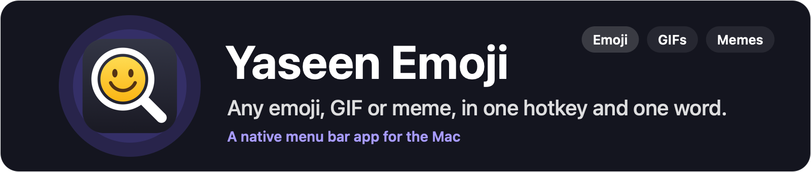

  
  
  

  <a href="https://github.com/yaseenarshad/yaseen-emoji-app/releases/latest"><b>Download</b></a> ·
  <a href="#the-answer">How it works</a> ·
  <a href="#the-keys">Keys</a>

  <b>Any emoji, GIF or meme, in one hotkey and one word.</b>

  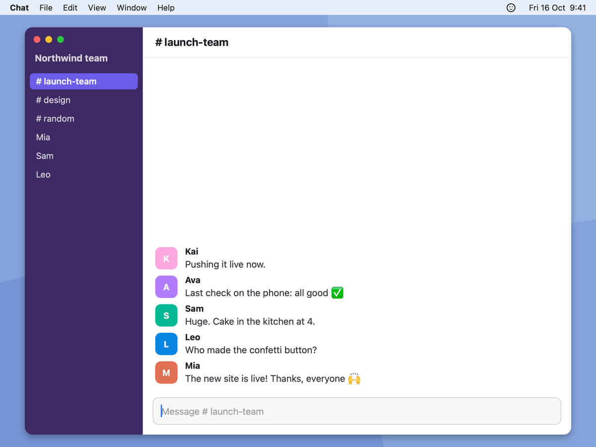

  <a href="https://github.com/yaseenarshad/yaseen-emoji-app/releases/latest"><b>Download for Mac</b></a> 
  Free · Apple Silicon · macOS 14 or later · 3.3 MB

## The problem

If you work online, text is most of what people see of you, and text can't smile. Emojis, GIFs and memes carry your tone. But Slack, Telegram, WhatsApp and iMessage each keep their own set and their own history, so your favourites are never where you need them. Yaseen Emoji gives you one place for all of them: one hotkey, the same favourites in every app, and it learns which ones you reach for.

Maybe you know these moments:

- You know the perfect GIF. It is in Telegram, and you are in Slack.
- You type "laugh" and scroll past forty faces to the one that you use each day.
- You saved a great meme last month. Now you can't find it, because no app searches the words in a picture.

  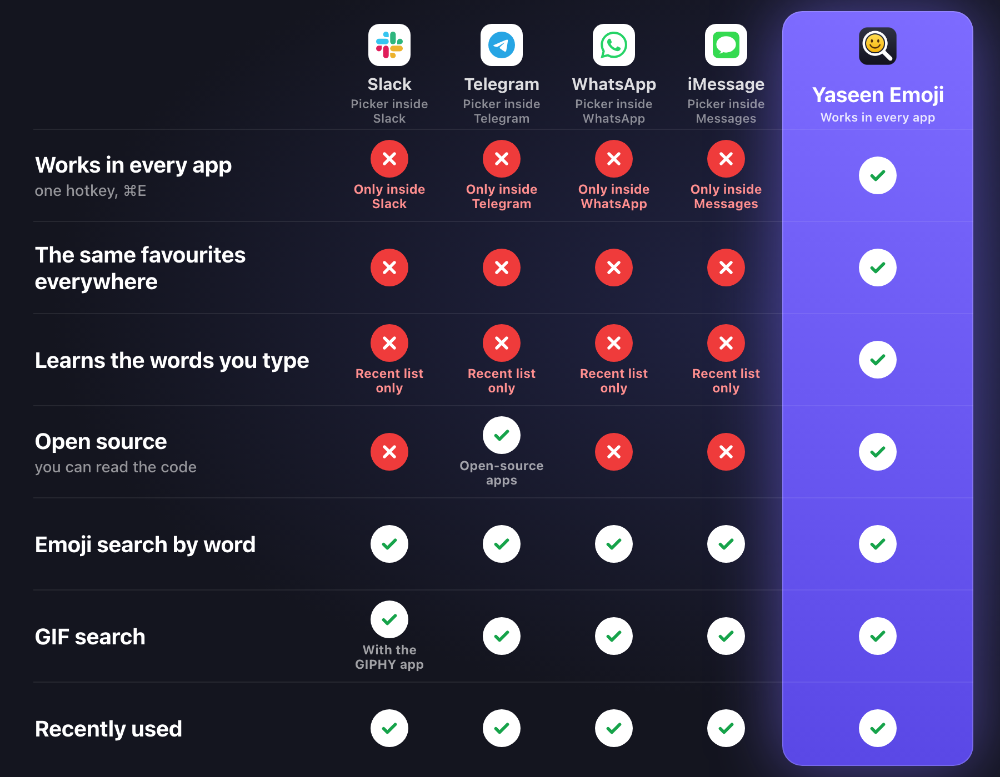

Slack, Telegram, WhatsApp and iMessage are the emoji and GIF pickers inside their Mac apps, as their help pages describe them on 16 Oct 2026. Slack shows GIFs when a workspace adds the GIPHY app.

## The answer

Yaseen Emoji puts every emoji, your GIFs and your memes behind one hotkey, in each app on your Mac.

<table>
  <tr>
    <td align="center" width="33%">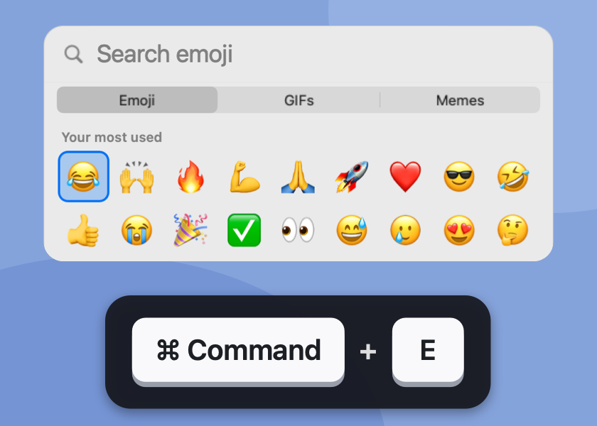 <b>1. Press ⌘E</b> The panel opens over any app.</td>
    <td align="center" width="33%">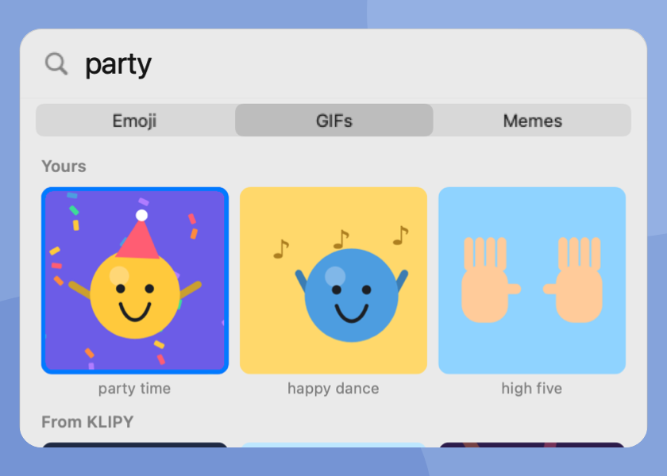 <b>2. Type a word</b> The best match is first.</td>
    <td align="center" width="33%">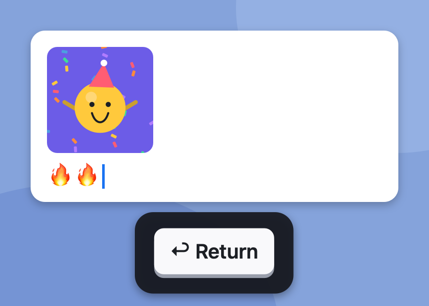 <b>3. Press Enter</b> It pastes. Add more, then press Esc.</td>
  </tr>
</table>

## What it does

### Your favourites, in every app

The same panel opens over Slack, Telegram, WhatsApp, Messages, Mail and your browser. Your most used emojis, GIFs and memes are at the top, in each app.

**So what:** you stop hunting for a GIF in the one app that has it. You have one collection, and it goes where you type.

  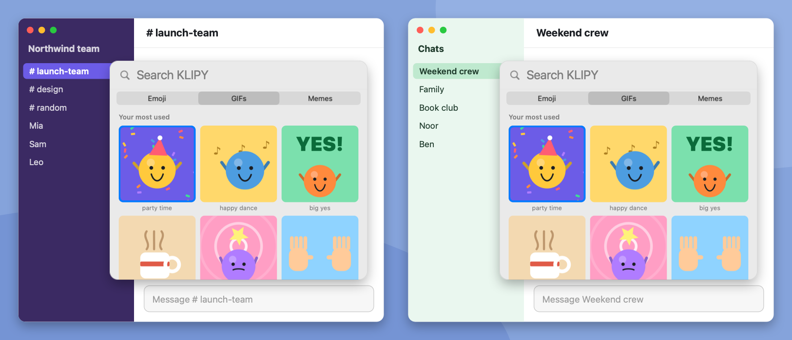

### It learns your words

Search a word, and pick any GIF, meme or emoji. The next time, that word puts your pick first. Right-click a tile to add a word yourself.

**So what:** you never teach it a list. You use it, and it learns how you talk.

  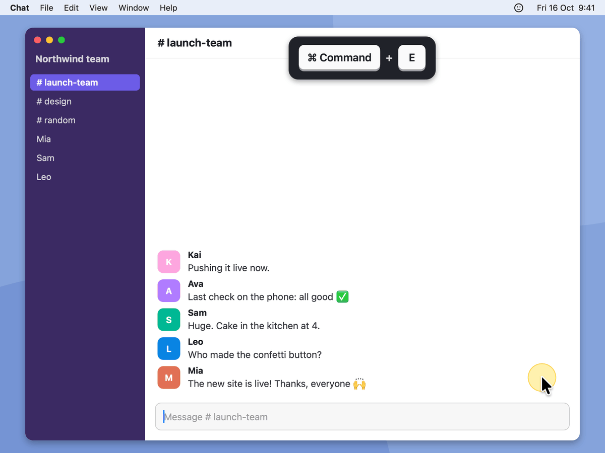

### Find a meme by the words in it

When you add a meme, your Mac reads the words in the picture, on your Mac only. Each tile has a title below it. On the Memes tab, a big preview shows the meme with the blue box.

**So what:** "coffee" finds the meme that says "me before coffee". You see the joke before you send it.

  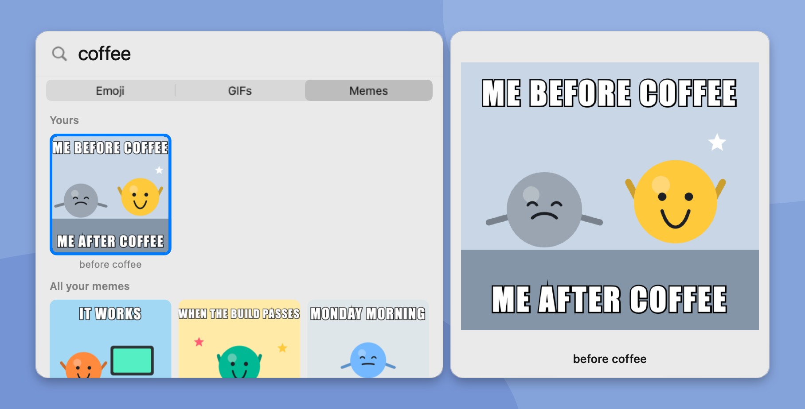

### Keep your own GIFs and memes

Drop GIFs, videos and memes into the add window, or paste them. A video becomes a GIF. The title comes from the file name. Type one word, and click Add.

**So what:** the GIFs from your phone and your group chats are in one place, and one word finds them.

  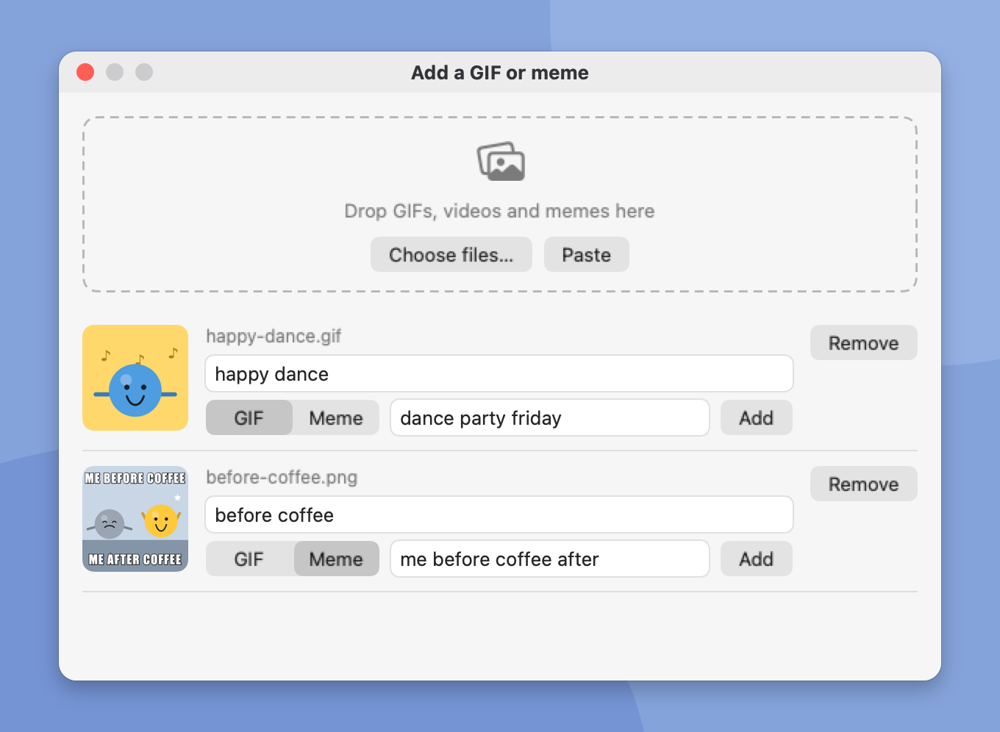

### Make it yours

Change the hotkey. Choose Paste or Copy only for emojis, GIFs and memes. Turn the online search on or off for each tab. Point the app at a folder that syncs, and your Macs share one history and one collection.

**So what:** it fits the way that you work, on each Mac that you use.

  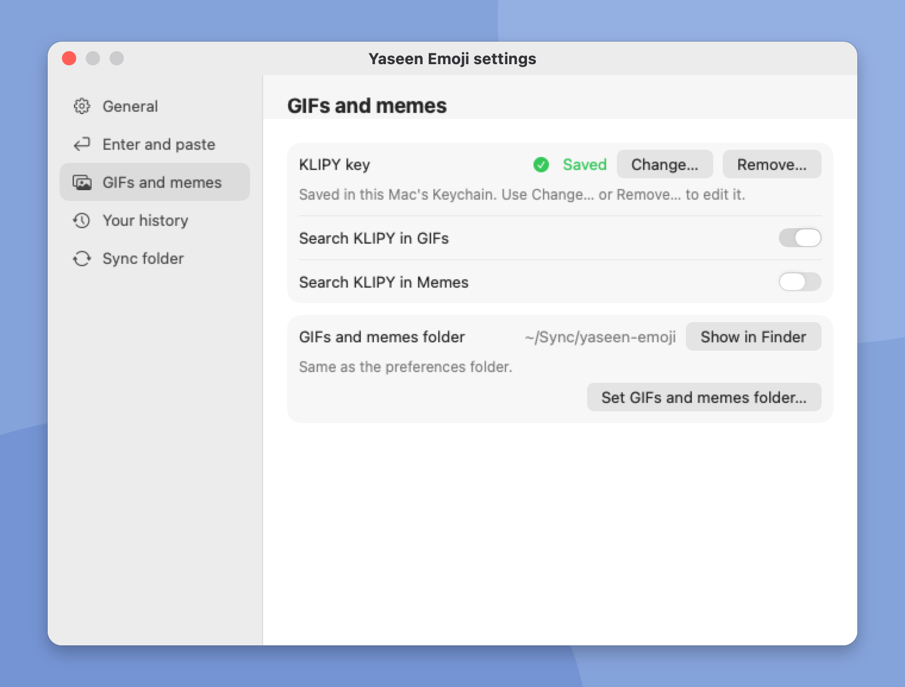

### Small things

- **Online GIFs, if you want them.** With a free KLIPY key, the GIFs tab also searches KLIPY. Your own GIFs always come first.
- **Two of the same.** Enter pastes and the panel stays open. Press Enter again for 🔥🔥.
- **1,914 emojis of Emoji 17,** with about 10 search words each. "haha", "praise" and "launch" all find their emoji.
- **One skin tone for all.** Set it one time in Settings.
- **No Dock icon.** The app lives in the menu bar.

## The proof

Each number is measured, not estimated. They are from the code of v0.2 on one Mac: an M1 Max with macOS 26.

| What | Number |
| -- | -- |
| The app | 3.3 MB |
| The download | 1.3 MB |
| Search of all 1,914 emojis | under 1 ms for each word |
| Search of 2,000 GIFs and memes | under 1 ms for each word |
| A 5 second video into a GIF | 0.46 s |
| Automatic tests | 171 |

What the app does not need:

- No account.
- No payment.
- No internet for emojis. Only the GIFs and Memes tabs go online, and only to KLIPY.
- No outside code. It is a native Mac app, written in Swift.

## The doubts

**Is it safe? What goes online?**
The Emoji tab never goes online. The GIFs and Memes tabs go online only to KLIPY, and only when the KLIPY switch of that tab is on (Memes is off at the start). The search needs your own free KLIPY key, and it sends only your search word. The key stays in the Keychain of your Mac. The app has no account and no tracking. The code is in this repo, and you can read it.

**Does it cost money?**
No. The app is free, with the [MIT license](LICENSE). The KLIPY key is free too.

**Why does macOS ask me two things at the first start?**
Apple has not notarized the app, so macOS stops it one time: click "Open Anyway" in System Settings › Privacy & Security. Then the app asks for Accessibility. It needs it to paste for you. Without it, a pick copies, and you paste with ⌘V.

**What happens to my GIFs if I stop using it?**
They stay yours. Your GIFs and memes are normal files in the folders `gifs/` and `memes/`, and the list is a JSON file next to them. Delete the app, and the files stay where they are.

## The download

[**Download the newest `.dmg`**](https://github.com/yaseenarshad/yaseen-emoji-app/releases/latest). The app needs a Mac with Apple Silicon and macOS 14 or later.

1. Open the `.dmg`. Drag **Yaseen Emoji** to **Applications**.
2. Open the app. Go to **System Settings › Privacy & Security** and click **Open Anyway**.
3. Turn on **Accessibility** for Yaseen Emoji when the app asks.

The smiley is now in your menu bar.

The first three things to try:

1. In any text box, press **⌘E**, type `fire`, and press **Enter** two times. Press **Esc**.
2. Click the smiley, then **Add a GIF or meme…**. Drop a GIF, type one word, and click **Add**. Press **⌘E**, press **Tab**, and type that word.
3. Open **Settings › GIFs and memes**, click **Get a free key**, and paste your KLIPY key. Then search `party` on the GIFs tab.

## The keys

| Key | What it does |
| - | - |
| ⌘E | Open the panel. Press it again to close the panel. You can change this key in Settings. |
| Enter, or a click | Paste the item with the blue box. The panel stays open, and the word stays selected. Enter again pastes it again. A new word replaces the old one. |
| Shift+Enter | Paste, and close the panel. |
| Esc | Close the panel. |
| Tab, Shift+Tab | Go to the next tab, or the one before: Emoji, GIFs, Memes. ⌘1, ⌘2 and ⌘3 also go to a tab. |
| Arrow keys | Move the blue box. |
| ⌘C | Copy the item only, and close. |
| Right-click | "Add a word…", "Copy only", and more for each kind. On your own GIF or meme: "Rename…" and "Show in Finder". On a KLIPY GIF: "Save to your GIFs". In "Your most used", also "Hide from Your most used". |
| Press and drag | Move the panel. The next open puts it in the middle again. |

Settings › Enter and paste can make Enter close the panel, as Shift+Enter does.

## Where your files are

- **Your history and your list:** in the preferences folder. The default is `~/Library/Application Support/Yaseen Emoji`. Each Mac writes its own `you-<Mac name>.json` and `library-<Mac name>.json`.
- **Your GIFs and memes:** in `gifs/` and `memes/`, in the preferences folder by default. Settings › GIFs and memes can move them to a different folder.
- **One file is at most 10 MB,** after a video becomes a GIF. The app takes GIF, MP4, MOV, PNG, JPEG and HEIC.
- **Two Macs:** point each Mac at one folder that syncs (Settings › Sync folder). Each Mac adds up the files of all Macs.

## For developers

Yaseen Emoji is one Swift package with no outside package. The [developer page](docs/DEVELOPMENT.md) tells how to build, test, sign and release it, and how each part of the code works. The sources of the emoji data and the KLIPY terms are in [THIRD-PARTY-NOTICES.md](THIRD-PARTY-NOTICES.md).

The license is [MIT](LICENSE).
